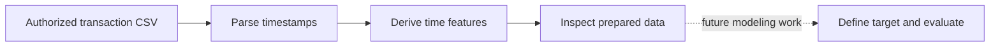

# Payment Failure Predictor


An exploratory notebook for examining transaction data and preparing time-based features for a payment-failure prediction study.

## Notebook

[model.ipynb](model.ipynb) loads a banking transaction CSV, parses timestamps, and derives time features such as transaction hour, day of week, weekend status, and peak-hour status.

## Data preparation flow



The repository currently contains the notebook only. It does not include the referenced CSV, a trained model artifact, an API, or an application interface. It is an exploratory analysis project, not a ready-to-deploy predictor.

## Run the notebook

The notebook currently uses a local Windows CSV path. Obtain data you are authorized to use and update its `read_csv` path. Do not commit financial data or personal identifiers.

```bash
 git clone https://github.com/Sameer-ship-it/Payment-Failure-Predictor.git
 cd Payment-Failure-Predictor
 python -m venv .venv
```

Activate the environment and install the notebook libraries:

```powershell
.venv\Scripts\Activate.ps1
python -m pip install jupyter pandas numpy scikit-learn matplotlib
jupyter notebook model.ipynb
```

On macOS or Linux, activate with `source .venv/bin/activate`.

## Scope and next steps

This notebook does not yet define a validated target, train a production model, or report performance. A payment-risk system would also need leakage-safe evaluation, calibrated metrics, data protection, monitoring, and operational review.

## Author

[Sameer Raza](https://github.com/Sameer-ship-it)
